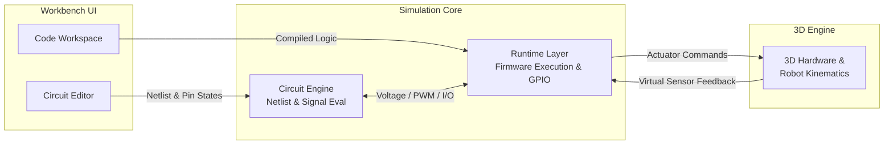

<div align="center">
  

 <div align="center">

# 💨 MagicSmoke

**Wire it. Code it. Watch it move—without frying physical boards.**

An open-source, browser-based playground unifying electronic circuit design, embedded firmware execution, and interactive 3D robotics simulation in a single workspace.

[Vision](#the-why) · [Features](#features--status) · [Architecture](#system-architecture) · [Getting Started](#getting-started) · [Roadmap](#roadmap) · [Contributing](#contributing)

[](#project-status)
[](https://www.typescriptlang.org/)
[](https://playwright.dev/)
[](LICENSE)

</div>

---

<!-- Optional: Uncomment and replace with a screenshot or GIF of the MagicSmoke workbench once ready
<div align="center">
  
</div>
-->

## ⚡ The Why

Every robotics builder knows the pain of fragmented workflows: designing schematics in one tool, writing firmware in another, and praying you don't release the literal "magic smoke" when hooking up motor drivers and power rails on a physical breadboard.

**MagicSmoke** brings the entire hardware-to-motion loop into a single browser tab:
1. **Wire** microcontrollers, sensors, and motor drivers on a virtual canvas.
2. **Code** embedded firmware right beside your schematic.
3. **Simulate** GPIO/PWM signals driving a 3D robot assembly in real time.

---

## 🛠️ Features & Status

MagicSmoke is actively evolving. Current capabilities and upcoming milestones are tracked transparently below:

| Module | Capability | Status |
| :--- | :--- | :--- |
| **Circuit Editor** | Interactive node wiring, pin mapping, and component placement | 🟢 Active |
| **Code Workspace** | In-browser embedded code authoring and project state sync | 🟢 Active |
| **3D Viewport** | Interactive 3D visualization of hardware and robot assemblies | 🟢 Active |
| **Hardware Modeling** | Standardized definitions for boards, sensors, and actuators | 🟡 In Progress |
| **Closed-Loop Sim** | Live GPIO/PWM bridging between firmware, motors, and physics | 🟡 In Progress |

> **Note:** Hardware coverage, microcontroller cycle accuracy, and physics constraints are under active development. Do not rely on runtime behavior for safety-critical electrical validation.

---

## 🏗️ System Architecture

MagicSmoke is built in **TypeScript** with a decoupled, four-layer architecture designed to keep UI responsiveness separate from electrical evaluation and 3D rendering:



- **Workbench UI:** Manages schematic capture, wire routing, and the embedded code editor.
- **Circuit Engine:** Evaluates netlists, pin connectivity, electrical checks, and signal propagation.
- **Runtime Layer:** Executes user firmware and bridges virtual GPIO/PWM registers to connected hardware models.
- **3D Engine:** Translates electrical actuator states (e.g., H-bridge PWM outputs) into mechanical motion and feeds environmental sensor data back into the runtime.

---

## 🚀 Getting Started

### Prerequisites

- **Node.js** 18.x or later
- **npm** (v9+)

### Installation

```bash
# 1. Clone the repository
git clone [https://github.com/After-Byte/MagicSmoke.git](https://github.com/After-Byte/MagicSmoke.git)
cd MagicSmoke

# 2. Install dependencies
npm install

# 3. Start the local development server
npm run dev
```

Open **`http://localhost:5173`** in your browser to launch the workbench.

### Available Scripts

| Command | Description |
| :--- | :--- |
| `npm run dev` | Starts the local development server with hot-reload |
| `npm run build` | Compiles TypeScript and bundles the application for production |
| `npm run test` | Runs unit and integration tests for the circuit and runtime engines |
| `npx playwright test` | Runs end-to-end browser automation tests across the workbench UI |

---

## 🗺️ Roadmap

*Priorities are directional and evolve with community feedback.*

- [x] **Phase 01: Reliable Foundation**
  - [x] Core circuit wiring, component placement, and 3D viewport scaffolding
  - [ ] Deterministic project state management and error boundary handling
  - [ ] Automated unit and Playwright E2E test suites for core workflows
- [ ] **Phase 02: Growing Hardware Library**
  - [ ] Expand microcontrollers, IR/ultrasonic sensors, and DC motor drivers
  - [ ] Document GPIO electrical constraints and pinout definitions
  - [ ] Standardize declarative component schemas for easy community contributions
- [ ] **Phase 03: Connected Code & Simulation**
  - [ ] Bridge live GPIO and PWM outputs directly to simulated actuators
  - [ ] Feed virtual sensor readings back into running firmware loops
  - [ ] Refine differential drive and motor kinematics
- [ ] **Phase 04: Richer Robotics Environments**
  - [ ] Custom arenas, line-following tracks, and dynamic obstacles
  - [ ] Rigid-body collision handling and physics tuning
- [ ] **Phase 05: Open Simulation Ecosystem**
  - [ ] Project export/import, shareable URLs, and community component registry
  - [ ] Support for additional microcontroller architectures and runtimes

---

## 🤝 Contributing

MagicSmoke is built for hardware hackers, robotics students, and simulation nerds—contributions of all sizes are welcome!

1. **Bug Reports & Ideas:** Open an issue describing the bug or hardware component you'd like to see modeled.
2. **Component Models:** Help expand the library of sensors, actuators, and boards.
3. **Core Engineering:** Jump into the circuit evaluator, firmware runtime, or 3D kinematics engine.

> **Before starting substantial changes:** Please open a GitHub Discussion or Issue first so we can align on architecture and avoid duplicate effort.

---

## ⚠️ Project Status

**Early Development (Experimental)** — Expect evolving internal APIs, partial hardware coverage, and ongoing physics tuning. Star ⭐ the repo to follow progress or jump into the issues to help shape the simulator!

## 📄 License

Distributed under the [MIT License](LICENSE).
