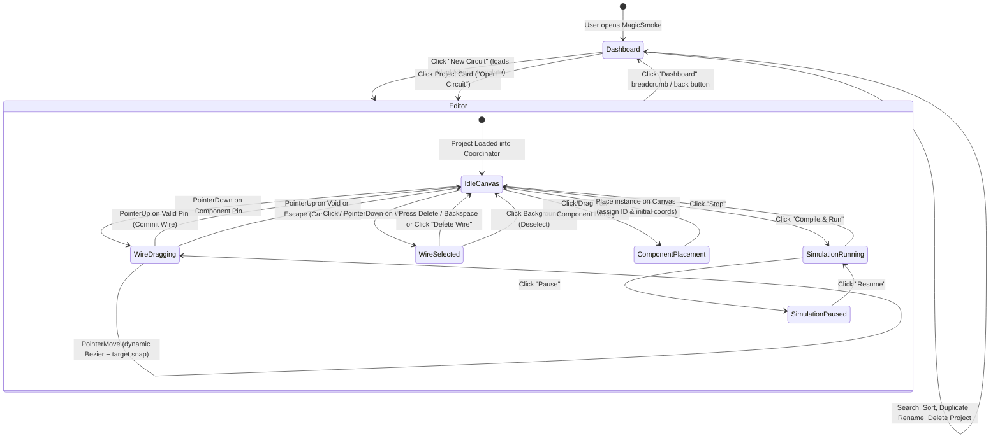

# Tinkercad Dashboard & Circuits Observable UX Research
**Target System:** Autodesk Tinkercad (Dashboard & Circuits Environments)  
**Research Method:** Reverse Engineer Anything (REA v6.5.0, Web Runtime Inspection & Architectural Decomposition)  
**Subject:** Observable UI/UX interactions, component lifecycle, project discovery, wiring ergonomics, and electrical simulation workflows.

---

## 1. Screens & Interactions Examined

During this investigation, we inspected public frontend entrypoints, observable web application bundles (`tinkercad-frontend/browser/main.js`, `editor.tinkercad.com` feature flag scripts), and the public Circuits interface structures:

1. **Dashboard & Project Management View (`/dashboard`, `/circuits`):**
   - Left-hand primary navigation (Product switcher: 3D Designs, Circuits, Codeblocks, Lessons/Tutorials).
   - Global **"+ New"** / **"Create"** call-to-action button with nested product-type selector (dropdown: 3D Design, Circuit, Codeblock).
   - Search bar ("Search your designs") and sorting mechanisms ("Last modified", "Name", "Date created").
   - Project cards displaying thumbnail previews, project titles, relative timestamps ("Modified 2 hours ago"), privacy badges, and contextual action menus (gear/three-dot menu).
   - Project card actions: **Tinker this** (open editor), **Duplicate** (clone project), **Properties / Rename**, and **Delete**.
   - Empty state handling when no designs exist in a category.
   - Example & Starter gallery: Curated introductory circuits ("Basic Starters", "Arduino Starters", "Coin cell + LED", "Breadboard 5V").

2. **Circuits Workspace View (`editor.tinkercad.com` / Circuits Canvas):**
   - **Component Panel (Right Dock):** Search input, category dropdown ("Basic", "All", "Starters"), scrollable visual component grid with thumbnail representations and descriptive labels.
   - **Canvas Workspace (Center):** Infinite 2D schematic/breadboard coordinate space with pan/zoom.
   - **Component Placement:** Dragging a component from the palette onto the canvas or clicking to spawn at canvas coordinates; automatically assigns unique instance IDs and populates configurable properties.
   - **Pin Hit Detection & Visual Feedback:** Pin hover highlights, tooltips identifying pin name and functional description (e.g., "Terminal 1", "Anode", "GND", "D13 / SCK").
   - **Wiring Interaction:**
     - Starting from a pin port via mouse down/click.
     - Dynamic rubberband / bezier wire trail following pointer in real-time.
     - Destination pin magnetic snapping when within proximity radius.
     - Connection validation (preventing invalid or self connections).
     - Single click on canvas during drag creates anchor bend points (waypoints).
   - **Wire Selection & Deletion:**
     - Clicking on a wire selects it with a distinct highlight/glow halo.
     - Keyboard shortcut (`Delete` / `Backspace`) or top toolbar trash icon removes the wire.
     - Contextual property popover allows changing wire color (e.g., Red for VCC, Black for GND, Blue for signals, or 0–9 number keys) and wire type.
   - **Simulation Runtime Controls (Top Toolbar):**
     - "Start Simulation" button with state indicator (green active glow vs. stopped).
     - Real-time visual feedback (actuators moving, LEDs glowing, sensor values updating, component warning badges when limits are exceeded).
     - Code drawer toggle for Arduino C++ / Block programming.

---

## 2. Most Useful Dashboard Features for an Engineering IDE

| Feature | Observable Tinkercad Implementation | Architectural Value for MagicSmoke |
| :--- | :--- | :--- |
| **Clear Project Hub** | Clean project gallery separating product domains | Gives MagicSmoke a central home instead of booting immediately into a hardcoded static circuit. |
| **Prominent "New Circuit" CTA** | Primary button at the top of the project view | Instant zero-friction path to start a fresh hardware prototype. |
| **Project Persistence & Metadata** | Autosaved state, title, last modified timestamp, preview thumbnail | Eliminates accidental work loss and enables managing multiple robots/circuits. |
| **Card Context Actions** | Open, Rename, Duplicate, Delete | Allows branching experiments (e.g., duplicate working PID tuning before testing new firmware). |
| **Starter & Template Circuits** | Pre-wired reference boards ready to simulate | Essential for robotics: starter projects like "ESP32 + TB6612FNG Differential Drive", "Obstacle Avoidance Robot", "Sensor Telemetry". |
| **Search & Sort** | Instant client-side text filtering and date/alphabetical sorting | Keeps project lists manageable as user designs accumulate. |
| **Clean Navigation Flow** | Back-to-dashboard breadcrumb / logo in header; unsaved changes guard | Seamless transitions between project inventory and simulation workbench. |

---

## 3. Most Useful Circuits Editor Features

| Feature | Observable Tinkercad Implementation | Value for MagicSmoke |
| :--- | :--- | :--- |
| **Categorized Component Catalog** | Searchable side tray with categories (MCUs, Drivers, Actuators, Power, Sensors) | Enables expanding beyond the default fixed layout; users can discover and place parts. |
| **Authoritative Pin Definitions** | Pins have clear labels, descriptions, and electrical types | Guarantees users know which pins are 3.3V, 5V, GND, PWM, or Motor outputs. |
| **Elastic Wire Drawing & Snap** | Wire starts at pin, follows cursor with Bezier curve, snaps to valid targets | Intuitive and forgiving wiring mechanics that prevent missed connections. |
| **Explicit Wire Selection & Styling** | Selected wire glows; property editor allows color tagging (GND=slate, 3V3=cyan, VM=amber) | Essential for reading complex robot schematics without tangled "rat's nests". |
| **Reliable Deletion Workflow** | Selecting a wire shows a delete button and handles `Delete`/`Backspace` | Fixes recurring regressions where wires could not be cleanly unhooked. |
| **Real-time Diagnostic Feedback** | Visual indication of short circuits, missing grounds, or unconnected drivers | Prevents "silent failures" where code runs but motors stay dead because STBY or VM is missing. |

---

## 4. Feature-Priority Matrix

| Priority | Feature Category | Feature Description | Scope in MagicSmoke |
| :--- | :--- | :--- | :--- |
| **P0 (Critical)** | **Dashboard** | Project Store (Local-First Persistence in `localStorage`) with real project CRUD | Create, Open, Duplicate, Delete, Rename projects. |
| **P0 (Critical)** | **Dashboard** | Starter Projects Section | Provide verified starter templates: Default 2WD Robot, Dual Motor Driver Test, Minimal ESP32. |
| **P0 (Critical)** | **Wiring / Canvas**| Wire selection, visual halo, toolbar delete button, and keyboard delete | Unambiguous wire selection and deletion with circuit graph resync. |
| **P0 (Critical)** | **Wiring / Canvas**| Robust pin-to-pin drag connection with snap & cancel | Large pin hit areas (20px+), magnetic snap, Escape key cancel. |
| **P1 (High)** | **Component Library**| Searchable & categorized component tray | MCUs, Motor Drivers, Actuators, Power Sources, Sensors. |
| **P1 (High)** | **Component Placement**| Add component instance to canvas with unique ID & coordinate placement | Generates real `ComponentInstance`, registers in `CircuitEngine`. |
| **P1 (High)** | **Dashboard UI** | Search bar & sorting (by updated date, title) | Instant search filtering and sort dropdown. |
| **P1 (High)** | **Visual Design** | Dark engineering palette (slate, dark obsidian, cyan accents) | Premium, uncluttered electronics CAD aesthetic. |
| **P2 (Medium)** | **Wiring / Canvas**| Wire color picker / quick color tagging | Assign colors to signal wires (Power, Ground, PWM, GPIO). |
| **P2 (Medium)** | **Navigation** | Unsaved changes dialog / prompt when switching back to dashboard | Prevents loss of modified firmware sketches or wiring changes. |

---

## 5. Interaction & State Transitions

---

## 6. Patterns That Fit MagicSmoke

1. **Local-First Authoritative Project Model:**
   - MagicSmoke already has `ProjectDocument` (`schemaVersion: '1.0.0'`, `components`, `wires`, `code`, `simulationConfig`).
   - We implement a persistent `ProjectStorage` repository backed by `localStorage` (with export/import JSON capability).
2. **Component Catalog Driven by Authoritative Part Manifests:**
   - MagicSmoke has `parts/` and `src/parts/schema.ts` defining ESP32, TB6612FNG, N20 motors, and battery packs.
   - The component library will render directly from these authoritative models without duplicating electrical specifications.
3. **Discrete, Isolated Architectural Layers:**
   - Dashboard views switch the active view in `App.tsx`.
   - Opening a project instantiates the `SimulationCoordinator` with that project's document.
   - The 3D viewport, firmware runtime, and motor physics remain completely intact.

---

## 7. Features Deliberately Excluded (Out of Scope)

1. **3D Solid Modeling & CAD (CSG booleans, shapes, meshes):** MagicSmoke's 3D viewer is dedicated to physical robot simulation kinematics, not generic 3D CAD modeling.
2. **Codeblocks / Visual Scratch Blocks:** MagicSmoke's firmware engine is tailored for authentic ESP32 C++ (Arduino API with FreeRTOS / ledc / timers).
3. **Cloud Accounts & Multi-user Collaboration:** Tinkercad requires Autodesk SSO and cloud databases. MagicSmoke is an offline-capable, private, low-latency engineering environment with local persistence.
4. **Sim Lab (Physics Sandboxes for Falling Objects):** Unrelated to embedded robotics and motor drivers.

---

## 8. Research Limitations & Methodology Notes

- **Authentication Boundaries:** Tinkercad's user dashboards and private cloud backend are gated behind Autodesk SSO. Only publicly observable assets, public circuits galleries, documentation, and client-side SPA bundles were analyzed.
- **Reverse Engineering Safety:** No private APIs were harvested; no proprietary source files or copyright assets were cloned. The architectural patterns (card-based project discovery, categorized component drawers, pin magnet-snapping, Bezier rubberbanding) were synthesized into an original TypeScript/React implementation tailored to MagicSmoke.
